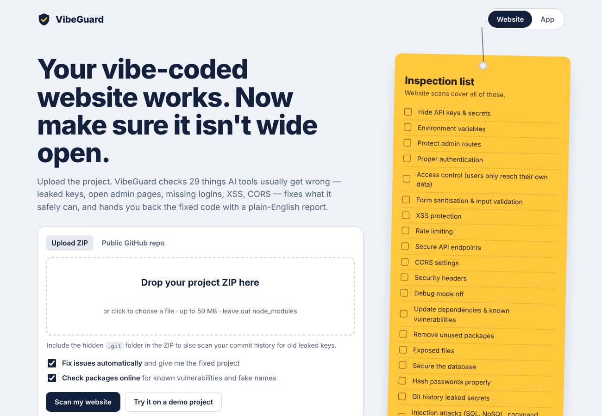
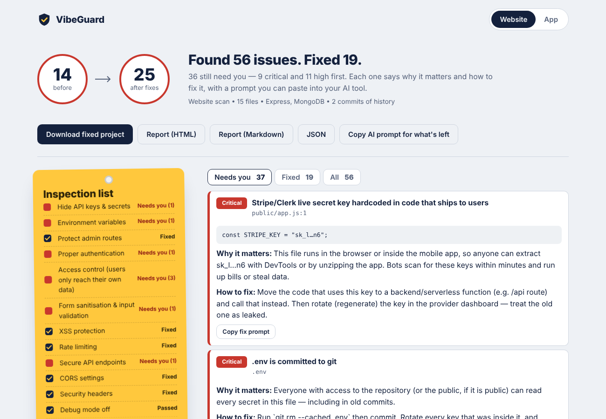
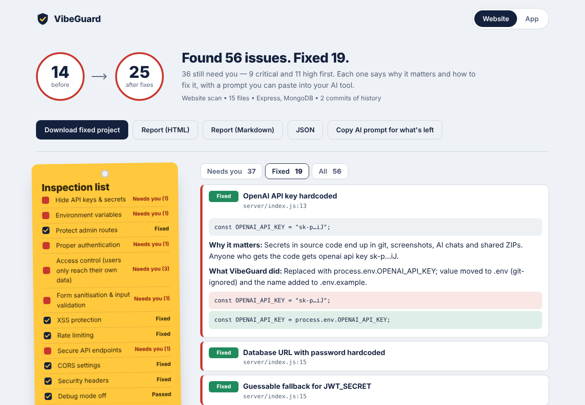
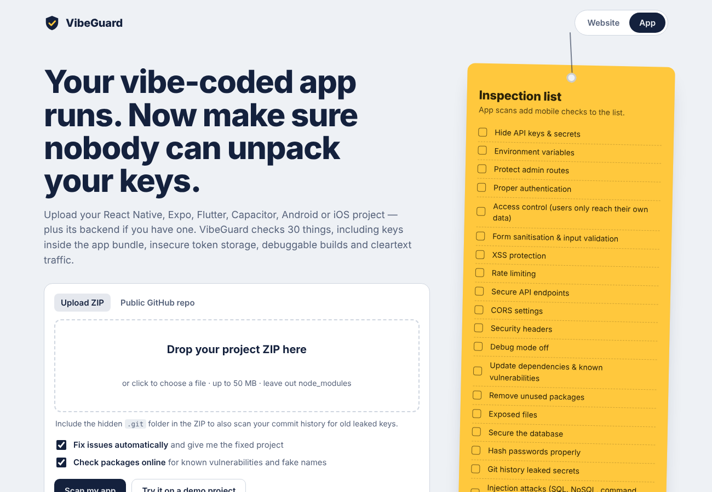
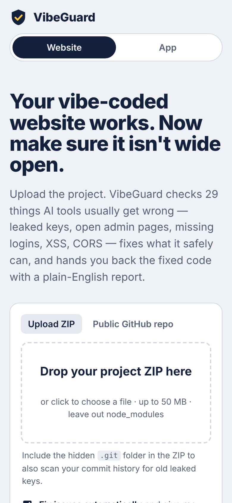

# VibeGuard

**Security check for vibe-coded websites and apps.** Upload your project (ZIP or public GitHub link), pick **Website** or **App**, and VibeGuard finds the security holes AI coding tools usually leave behind — then fixes what it safely can and gives you back the fixed project with a plain-English report of everything it did.

- **Zero dependencies.** Plain Node.js (18+). No `npm install`, nothing to keep patched, nothing to hijack.
- **Never runs your code.** It only reads files.
- **Private by default.** Uploads are deleted as soon as the scan finishes; results after 30 minutes (or instantly with *Delete my data*).
- **Website, installable app, CLI and GitHub Action** — same engine everywhere.

> VibeGuard catches common, known mistakes. It cannot guarantee an app can't be hacked. Rotate any key it finds, and get a professional review before you handle payments or sensitive data at scale.

## Screenshots

| Website section | Scan results |
|---|---|
|  |  |
| **What VibeGuard fixed (before → after)** | **App section** |
|  |  |

<p align="center"></p>

## Try it

**Online:** [](https://render.com/deploy?repo=https://github.com/tejashalo/security-fix-project) — free; sign in with GitHub and Render gives you a public link like `https://vibeguard.onrender.com`.

**On your computer (Windows):** download this repo (Code → Download ZIP), unzip, and double-click `start-windows.bat`. On macOS/Linux run `./start.sh`. The site opens at http://localhost:3000.

---

## What it checks (and fixes)

| # | Check | What VibeGuard does automatically |
|---|---|---|
| 1 | **Hide API keys** — OpenAI, Anthropic, Stripe, AWS, GitHub, Google, Supabase service_role, DB URLs, 25+ formats | Moves server-side keys to `.env`, replaces them with `process.env.X` / `os.environ.get("X")`, loads `.env`. Keys in browser/app code are flagged with how to move them to a backend |
| 2 | **Environment variables** | Adds `.env` to `.gitignore`, creates/updates `.env.example`, flags secrets behind `NEXT_PUBLIC_`/`VITE_`/`EXPO_PUBLIC_`, removes guessable fallbacks like `process.env.JWT_SECRET \|\| 'secret'` (writes a random secret to `.env`) |
| 3 | **Protect admin routes** | Inserts a fail-closed `vibeguardRequireAdmin` guard on Express admin routes / routers |
| 4 | **Proper authentication** | Flags endpoints that change data without a login check (Express, Next.js API routes & server actions, Flask, FastAPI), and projects with no auth at all |
| 5 | **Users only access their own data** | Flags IDOR (lookup by id without owner check), mass assignment (`create(req.body)`), and role taken from the request |
| 6 | **Sanitise forms / validate input** | Switches password forms from GET to POST; flags routes without a validation library (with a zod example) |
| 7 | **XSS** | `innerHTML` with plain data → `textContent`; EJS `<%-` → `<%=`; flags `dangerouslySetInnerHTML`, `v-html`, `{@html}`, `|safe`, tokens in localStorage |
| 8 | **Rate limiting** | Express: zero-dependency limiter (10/15 min on login & signup, 30 on AI routes, 300 elsewhere). Flask/FastAPI: in-app limiter. Next.js: tells you how (serverless) |
| 9 | **Secure API endpoints** | Body size limits, private-looking GET routes without auth, GraphQL introspection only outside production |
| 10 | **CORS** | `cors()` / `origin: '*'` → env-based allow-list (`ALLOWED_ORIGINS`); Flask-CORS, FastAPI and Django too |
| 11 | **Security headers** | CSP (report-only first so nothing breaks), HSTS, X-Frame-Options, nosniff, Referrer-Policy, Permissions-Policy — for Express, Next.js (middleware), Flask, FastAPI, Django, Vercel and Netlify |
| 12 | **Debug mode off** | `debug=True`, Django `DEBUG = True`, `ALLOWED_HOSTS=['*']`, production source maps |
| 13 | **Update dependencies** | Checks npm advisories and PyPI vulnerabilities; upgrades vulnerable and outdated packages within the same major version |
| 14 | **Remove unused packages** | Removes dependencies that nothing imports, requires, scripts or configures |
| 15 | **Exposed files** | Quarantines dumps, `.env`, keys and backups found in public folders; git-ignores keystores, service accounts, databases and logs |
| 16 | **Secure the database** | Generates a Supabase migration enabling Row Level Security, tightens open Firebase rules, binds DB ports to localhost, flags default passwords and disabled TLS |
| 17 | **Hash passwords properly** | Flags MD5/SHA/plain-text passwords; raises low bcrypt cost to 12 |
| 18 | **Git history leaked secrets** | Scans every commit; writes a ready `git filter-repo --replace-text` file to scrub them |
| 19 | **Full due-diligence audit** | All of the above plus the extras below, a score before/after, and a report |

**Extras added because vibe-coded apps get these wrong a lot:** SQL/NoSQL/command/code injection · CSRF · cookie flags, JWT expiry & verification · hallucinated / typo-squatted / malicious packages ("slopsquatting") · file uploads · SSRF, open redirects & path traversal · stack traces & secrets in logs · webhook signature checks (Stripe) · AI/LLM risks (keys in the browser, `dangerouslyAllowBrowser`, prompt injection, no token caps) · HTTPS & disabled TLS checks · Docker (root user, baked secrets, missing `.dockerignore`) · **mobile apps** (debuggable/allowBackup/cleartext Android builds, iOS ATS, AsyncStorage/SharedPreferences tokens, WebView bridges, Expo `extra` secrets, signing passwords).

## The report

After every scan you get:

- a **score before → after** and a checklist showing every area as *Fixed*, *Needs you*, *Passed* or *Not applicable*;
- every issue with **why it matters**, the **exact fix**, the **before/after line**, and a **copy-ready prompt** for Cursor, Lovable, Bolt, Replit or Claude;
- a **"Before you deploy"** list (rotate keys, apply the RLS migration, set `trust proxy`…);
- **diffs** of every file changed, plus downloads: fixed ZIP (with `VIBEGUARD_REPORT.md` inside), HTML, Markdown and JSON.

Secrets are always redacted in reports.

## Run the website

```bash
git clone https://github.com/tejashalo/security-fix-project.git
cd security-fix-project
npm start            # http://localhost:3000
```

No install step — there are no dependencies. `git` is only needed for the "scan a GitHub repo" option. Settings are in [.env.example](.env.example).

**Docker**

```bash
docker build -t vibeguard .
docker run -p 3000:3000 vibeguard
```

Behind a reverse proxy (Render, Railway, Fly, Nginx) set `TRUST_PROXY=1`.

The site has two sections — **/website** and **/app** — and installs as an app on phones and desktops (it's a PWA).

## Command line

```bash
node bin/vibeguard.js scan ./my-project              # fixed copy → ./my-project-vibeguard-fixed
node bin/vibeguard.js scan ./my-project --in-place   # apply fixes to your files
node bin/vibeguard.js scan project.zip --no-fix --report report.html
node bin/vibeguard.js scan . --mode app --offline
```

Your original folder is never modified unless you pass `--in-place`.

## GitHub Action

```yaml
- uses: actions/checkout@v4
  with:
    fetch-depth: 0          # full history so leaked secrets in old commits are found
- uses: tejashalo/security-fix-project@main
  with:
    mode: web               # or app
    fail-on: high
```

## Ignoring things

Create `.vibeguardignore` in your project:

```
# paths (globs)
scripts/seed.js
fixtures/
# whole categories
rule:unused
```

Or add `vibeguard-ignore` in a comment on the line.

## How it keeps your upload safe

- ZIPs are unpacked with checks for path traversal (zip-slip), zip bombs, symlinks and size limits; `node_modules` is skipped.
- Git history is read with hooks, external diff drivers and repo config disabled.
- Uploaded code is never executed. No dependencies are installed.
- The site itself uses a strict CSP, security headers, rate limits, same-origin checks and unguessable result links.

## Development

```bash
npm test     # node:test, no dependencies
npm run dev  # restarts on changes
```

Project layout:

```
server/index.js         HTTP server (built-in http module)
server/jobs.js          scan queue, temp folders, auto-delete
server/lib/scanner.js   runs all checks, scores, builds the result
server/checks/*.js      one file per area (secrets, env, routes, cors, deps, mobile…)
server/lib/templates.js code VibeGuard adds to your project
public/                 website + PWA (no framework)
bin/vibeguard.js        CLI
```

## License

MIT
